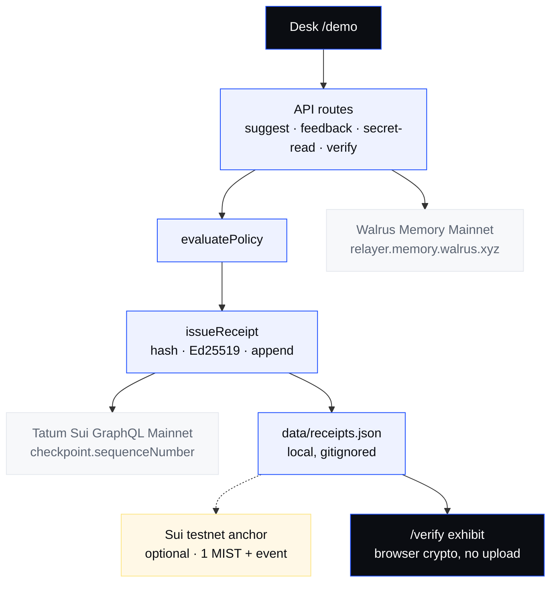
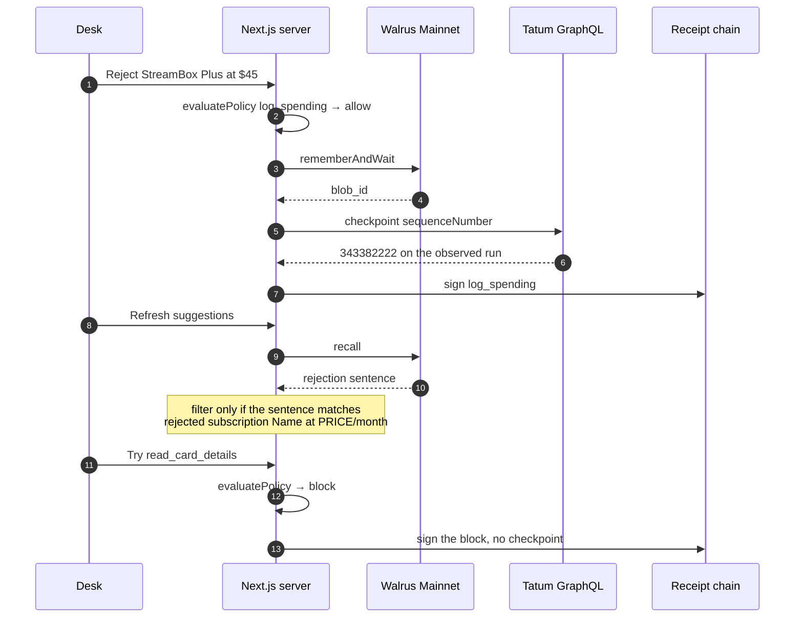
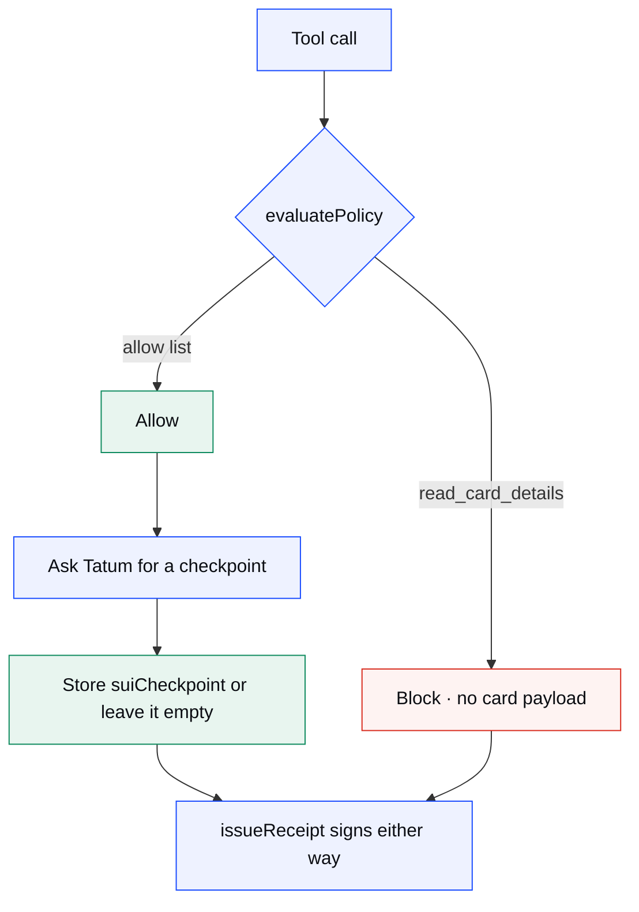

# LedgerMind

The agent remembers your spending refusal on Walrus Mainnet, and a signed receipt shows it never read your card.

Reject StreamBox Plus at $45. Walrus stores the rule. The next pass can filter it. `read_card_details` is blocked in policy and still signed.

Total Recall hackathon · Consumer finance · Tatum × Walrus Memory.

| | |
| :--- | :--- |
| See it | [https://ledger-m.vercel.app](https://ledger-m.vercel.app) |
| Run the proof | On your machine: `npm run dev`, then [http://localhost:3000/demo](http://localhost:3000/demo). Or `node --import tsx scripts/verify-e2e.mjs` |
| What works today | [Below](#11-what-works-today) |
| Blog | Not published yet. Draft: [docs/BLOG-total-recall.md](docs/BLOG-total-recall.md). Replace this line with the public URL when the post is live. |
| Repo | Public: [github.com/datharnu/LedgerMind](https://github.com/datharnu/LedgerMind) |

**Where the proof ran.** Walrus Memory writes use the Mainnet relayer `https://relayer.memory.walrus.xyz`. Tatum reads a Sui checkpoint from `https://sui-mainnet.gateway.tatum.io/graphql`. The optional receipt anchor is a Sui **testnet** transaction. It is not Mainnet.

The public site is the landing page and the desk chrome. On 9 November 2026 the hosted desk could not finish a suggestion: `GET https://ledger-m.vercel.app/api/suggest` returned HTTP 500, `ENOENT: mkdir '/var/task/data'`. Vercel cannot create `data/receipts.json`. The same deploy had Walrus, Tatum, and the testnet key configured (`/api/health`). The $45 loop in the table below was run locally, not on that URL. `/verify` on the public site still loads the offline exhibit.

One observed loop, 9 November 2026: a fresh namespace, one rejection, blob `WhWDQ7OAtumfwG33s7rnhMeFlOiiASz7n_Ut5_xIrFY`, receipt `c6523bf0-4e28-4728-a13b-e8fd37e746df` with `suiCheckpoint=343382222`.

| What has been observed | Where the boundary is |
| :--- | :--- |
| `rememberAndWait` returned `blob_id=zReARhjqYavhLRmwyiv3eJg1XNclXjlkAG8qoVHv35M`, status `done` | Your `MEMWAL_*` keys. Memwal has no wipe. |
| Recall filtered `E2E Probe 1794233170322` after the session map was cleared | The memory text must match `rejected subscription {name} at {price}/month`. A sentence that does not match can be recalled and the offer still recommended. |
| Ed25519 signature on receipt `c6523bf0-4e28-4728-a13b-e8fd37e746df` | Local `data/receipts.json`. The live file can FAIL when sequence numbers collide. That FAIL stays. The offline exhibit is the chain you tamper on purpose. |
| Tatum GraphQL checkpoint `343382222` stored as `suiCheckpoint` | Allow-path receipts only, and only when `TATUM_API_KEY` works. Tatum does not allow or block a tool. |
| Sui testnet publish [EERRm1NXTrkWwzHMfcRaogtx8cDQWzrUPE4bNRksizS8](https://testnet.suivision.xyz/txblock/EERRm1NXTrkWwzHMfcRaogtx8cDQWzrUPE4bNRksizS8), package `0x9287817efffc4db01d6d32634431517962cc3b7913ac66f183c34df4b898c92c` | Testnet gas. Optional. Not a user-fund transfer. |

The Sui anchor is testnet. Walrus and Tatum are Mainnet. No user funds move.

| | Chapter | |
| :--- | :--- | :--- |
| 01 | [The gap](#01-the-gap) | A refusal that dies when the chat ends |
| 02 | [The promise](#02-the-promise) | One reject, one memory, one receipt |
| 03 | [Architecture](#03-architecture) | The desk, the policy, two Mainnet hosts |
| 04 | [The life of a refusal](#04-the-life-of-a-refusal) | Reject, recall, block |
| 05 | [The guard](#05-the-guard) | Allow list, and the one blocked tool |
| 06 | [Tatum](#06-tatum) | A checkpoint, not a decision |
| 07 | [The testnet anchor](#07-the-testnet-anchor) | Optional, and not Mainnet |
| 08 | [Decisions](#08-decisions) | The forks this repo actually stood at |
| 09 | [Repository map](#09-repository-map) | Where the moving parts live |
| 10 | [Set up](#10-set-up) | `.env`, then the two proof commands |
| 11 | [What works today](#11-what-works-today) | Observed, unobserved, absent |

## 01. The gap

You tell the agent StreamBox Plus at $45 is too expensive. Next session it suggests StreamBox Plus at $45.

The refusal lived in the chat. The chat ended. Nothing in the suggestion path had to read it again, so the agent was free to ask twice.

A consumer does not need another budget dashboard for that. They need the refusal to show up on the next list, and a receipt that says the agent did not open the card while it was asking.

## 02. The promise

> Reject it once. Walrus keeps the rule. The receipt shows the card stayed closed.

Everything else in this repository is downstream of that sentence.

- **The UI is not the guard.** The block is `evaluatePolicy` inside `issueReceipt`, before a receipt is signed. A red row on the desk is the display of that decision.
- **The client may name the amount already in the catalog.** It does not name a payee. There is no merchant checkout, and this README will not imply one.
- **A missing feed is not a clean yes.** If Tatum does not return a checkpoint, the allow receipt is still signed and `suiCheckpoint` is empty.
- **A block is still a receipt.** `read_card_details` returns no card data and still lands on the tape.

## 03. Architecture

One Next.js app. Policy and signing sit on the server. Walrus and Tatum are two different Mainnet hosts. The Sui anchor is a third host, and it is testnet, so it is drawn as optional.

| Surface | Location | Role |
| :--- | :--- | :--- |
| Desk | [`src/app/demo/`](src/app/demo/) | The $45 loop a judge clicks |
| Routes | [`src/app/api/`](src/app/api/) | Suggest, feedback, secret read, verify, optional anchor |
| Policy | [`src/lib/policy.ts`](src/lib/policy.ts) | Allow list. One tool is blocked. |
| Receipts | [`src/lib/receipt.ts`](src/lib/receipt.ts) | Hash, sign, store. The only writer of the tape. |
| Walrus | [`src/lib/memwal-client.ts`](src/lib/memwal-client.ts) | `rememberAndWait` and `recall` on Mainnet |
| Tatum | [`src/lib/tatum.ts`](src/lib/tatum.ts) | GraphQL checkpoint on allow receipts |
| Anchor | [`src/lib/sui-client.ts`](src/lib/sui-client.ts) | Testnet gRPC, hardcoded |
| Verify | [`src/app/verify/`](src/app/verify/) | Live tape, plus the browser exhibit |



The dotted line is the point of the diagram. The $45 loop does not need the anchor. The anchor cannot promote itself to Mainnet by sitting next to a Mainnet blob id.

## 04. The life of a refusal

| Stage | Where | What it establishes |
| :--- | :--- | :--- |
| 01 · Suggest | `GET /api/suggest` | Open offers, plus any name the recalled text already rejected |
| 02 · Reject | `POST /api/feedback` | `rememberAndWait` on Mainnet, then a `log_spending` receipt |
| 03 · Recall | the next `GET /api/suggest` | The memory text is parsed. A matching name leaves the open list. |
| 04 · Block | `POST /api/policy/secret-read` | `read_card_details` is refused. The receipt has no checkpoint. |
| 05 · Verify | `/verify` | Recompute the hash and the Ed25519 signature. Tamper the exhibit on purpose. |



Two things in that diagram are the whole model. Walrus changes the next list only when the text matches the parser. Tatum never appears on the block path.

The same-session desk also keeps an in-memory map, so a refresh can hide the offer before recall returns. The end-to-end script clears that map before it asserts the filter. The PASS on 9 November 2026 is recall, not the map. Reason string: `Previously rejected: E2E Probe 1794233170322`.

## 05. The guard

Four tool names exist. Three are allowed. One is not.

| Tool | Decision | Checkpoint |
| :--- | :--- | :--- |
| `query_price` | allow | yes, when Tatum answers |
| `suggest_subscription` | allow | yes, when Tatum answers |
| `log_spending` | allow | yes, when Tatum answers |
| `read_card_details` | block | no |



There is no second path that signs a receipt without `issueReceipt`. A feature that writes a success row without going through it is a hole.

## 06. Tatum

Allow-path receipts POST this to `https://sui-mainnet.gateway.tatum.io/graphql` with the `x-api-key` header. Not JSON-RPC.

```text
{ checkpoint { sequenceNumber } }
```

The number is stored as `suiCheckpoint` on the receipt in `data/receipts.json`. A direct check on 9 November 2026 returned `343318009`. The end-to-end receipt stored `343382222`.

Tatum does not allow, block, price, or rank an offer. If the call throws, signing continues and the field stays empty. The desk must not render that empty field as a checkpoint.

## 07. The testnet anchor

Sui has no transfer memo. [`move/ledgermind/sources/anchor.move`](move/ledgermind/sources/anchor.move) emits `ReceiptBatchAnchored` with a batch hash. The transaction also does a 1 MIST self-transfer so there is a transaction to point at. The gas is testnet. The client in [`src/lib/sui-client.ts`](src/lib/sui-client.ts) hardcodes `https://fullnode.testnet.sui.io:443` and `network: "testnet"`. It does not read `SUI_GRPC_URL`.

Observed publish: [EERRm1NXTrkWwzHMfcRaogtx8cDQWzrUPE4bNRksizS8](https://testnet.suivision.xyz/txblock/EERRm1NXTrkWwzHMfcRaogtx8cDQWzrUPE4bNRksizS8).

Package: `0x9287817efffc4db01d6d32634431517962cc3b7913ac66f183c34df4b898c92c`.

Fund `SUI_PRIVATE_KEY` on testnet if you want the button. The $45 loop does not need it. This README will not call that transaction Mainnet.

## 08. Decisions

These are forks the code actually stood at. They are not a catalog of principles.

**1. The filter is a sentence, not a similarity score.** Recall can return a nearby memory and still leave the offer recommended. The isolated sentence `verify: user rejected subscription at 45 CNY because too expensive` came back as `blob_id=qKTJKKYbe2LLDUR9CAUJE_e081uDLIcOvTYMk23Wh10` and the $45 offer stayed in the list. The parser only removes a name from `rejected subscription {name} at {price}/month`, and a “too expensive” reason can also set a price cap. We did not relabel that as learning.

**2. Tatum is a stamp.** Putting the checkpoint on the allow path and not on the block path is deliberate. A refusal must not wear an allow-path time mark.

**3. The anchor client ignores the Mainnet URL in the example env.** `.env.example` used to say the anchor key was Mainnet gas. The code never spent that. The example now says testnet, and the client still does not trust the URL variable.

**4. A later green run does not delete a broken tape.** Concurrent `GET /api/suggest` calls have written duplicate sequence numbers. `/verify` reports FAIL. `data/receipts.json` is not rewritten to hide it. The committed exhibit at `public/samples/exhibit-chain.json` is the chain a judge can tamper. **Simulate tamper** must go to FAIL. Reload must go back to PASS.

**5. The session map is a lag hiding place, and the proof does not use it.** After `rememberAndWait`, the same process can filter the offer before recall is indexed. `scripts/verify-e2e.mjs` calls `resetSessionDecisionsForTests` before the assertion. If that line disappears, a PASS can mean “the process remembered,” which is not Walrus.

## 09. Repository map

```text
src/app/demo/                 the desk
src/app/verify/               live tape and the offline exhibit
src/app/memories/             Walrus learning log
src/app/evidence/             proof page and what this is not
src/app/api/suggest/          recall, then filter, then an allow receipt
src/app/api/feedback/         rememberAndWait, then log_spending
src/app/api/policy/secret-read/   the blocked card read
src/app/api/receipts/         list, verify, verify-chain, optional anchor
src/lib/policy.ts             the allow list
src/lib/receipt.ts            the only signer
src/lib/receipt-crypto.ts     hash and Ed25519 check, shared with the browser
src/lib/memwal-client.ts      Mainnet remember and recall
src/lib/tatum.ts              GraphQL checkpoint
src/lib/sui-client.ts         testnet gRPC, hardcoded
move/ledgermind/              the testnet event
public/samples/exhibit-chain.json
scripts/verify-memory.mjs     one Mainnet blob
scripts/verify-e2e.mjs        recommend, reject, filter, sign, stamp
docs/BLOG-total-recall.md     draft, not a public URL yet
```

`data/receipts.json` is gitignored. The live FAIL is on the machine that ran the desk. The exhibit in `public/samples/` is what the repo itself can verify without that file.

## 10. Set up

`.env` is gitignored. Copy the example and fill it. Do not commit the filled file.

```bash
cp .env.example .env
npm install
npm run dev
```

| Variable | What to put | Required for |
| :--- | :--- | :--- |
| `MEMWAL_PRIVATE_KEY` | Memwal key | Walrus writes and recall |
| `MEMWAL_ACCOUNT_ID` | Memwal account | Walrus writes and recall |
| `MEMWAL_RELAYER_URL` | `https://relayer.memory.walrus.xyz` | Must be this Mainnet host. A staging or dev URL is the wrong cluster. |
| `MEMWAL_NAMESPACE` | `ledgermind` | Memory namespace. The e2e script switches to a fresh one so it does not pretend to delete old blobs. |
| `TATUM_API_KEY` | Tatum key | Checkpoint on allow receipts |
| `RECEIPT_PROXY_SECRET_HEX` | 64-character hex | Ed25519 receipt signing. If empty, the server generates one for the process. |
| `SUI_PRIVATE_KEY` | 64-character hex or `suiprivkey1…` | Optional. Fund the wallet on **Sui testnet**. |
| `SUI_GRPC_URL` | Leave the example | The anchor client uses testnet gRPC itself. It does not spend Mainnet gas. |
| `SUI_ANCHOR_PACKAGE_ID` | Set after `npm run publish:anchor` | Optional testnet package |
| `PUBLIC_MEMORY_BLOB_IDS` | Comma-separated blob ids | Optional, when the memory API cannot list |

Run these steps with `npm run dev`. The public URL shows the pages. It does not append the tape.

| Step | Do this | You should see |
| :--- | :--- | :--- |
| 1 | Open `http://localhost:3000/demo` | StreamBox Plus at $45, still open |
| 2 | Reject it as too expensive | A Walrus Mainnet blob id, then the offer under Blocked |
| 3 | Refresh | The same offer stays filtered when recall returns that memory |
| 4 | **Try read_card_details** | Policy block. A signed receipt. No checkpoint on that row. |
| 5 | Open `/verify`, then **Simulate tamper** on the offline exhibit | FAIL. Reload exhibit returns PASS. |

`/memories` is the learning log. `/evidence` is the proof page and what this is not.

Check a Mainnet write without the UI:

```bash
node scripts/verify-memory.mjs
node --import tsx scripts/verify-e2e.mjs
```

`verify-memory.mjs` prints `PASS: blob_id=…` or `FAIL`. The e2e script recommends a probe, rejects it, checks the blob, the filter, the signature, and the stored checkpoint.

## 11. What works today

**Observed.** On 9 November 2026, with keys in `.env`:

| What | Evidence |
| :--- | :--- |
| Mainnet Walrus write | `node scripts/verify-memory.mjs` → `blob_id=zReARhjqYavhLRmwyiv3eJg1XNclXjlkAG8qoVHv35M`, status `done` |
| Recall changes the next list | `node --import tsx scripts/verify-e2e.mjs` → `Previously rejected: E2E Probe 1794233170322`, blob `WhWDQ7OAtumfwG33s7rnhMeFlOiiASz7n_Ut5_xIrFY` |
| Signed receipt and hash link | Receipt `c6523bf0-4e28-4728-a13b-e8fd37e746df`, sequence 220, Ed25519 valid, `previousHash=95cc4131feb2` |
| Tatum checkpoint stored | `suiCheckpoint=343382222` on that receipt. A separate GraphQL read returned `343318009`. |
| Testnet package publish | [EERRm1NXTrkWwzHMfcRaogtx8cDQWzrUPE4bNRksizS8](https://testnet.suivision.xyz/txblock/EERRm1NXTrkWwzHMfcRaogtx8cDQWzrUPE4bNRksizS8) |

**Built, not observed as part of the $45 loop.** The desk button that posts `/api/receipts/anchor` after `npm run publish:anchor`. It writes a batch hash on testnet. The loop above does not click it.

**Deliberately absent.** No card issuance. No PAN storage. No custody. No user-fund transfer. No zero-knowledge proof. No Sui JSON-RPC. No Mainnet anchor. No public blog URL yet.

**Open.** The live `data/receipts.json` on a long demo session can FAIL the chain check because suggestion requests have shared sequence numbers. The fix is to stop concurrent writers from minting the same sequence. Rewriting the file to print PASS is not the fix.

The hosted desk has the same hole in a sharper form. [ledger-m.vercel.app](https://ledger-m.vercel.app) returns 500 from `/api/suggest` because the server tries to `mkdir` `data/` inside the Vercel function filesystem. Keys are present. The write has nowhere to land. Pointing the store at `/tmp` would survive one warm instance and still disappear on the next cold start. A durable tape needs a store, and this repo does not have one. Until that exists, judge the loop on `npm run dev`.

## License

MIT
